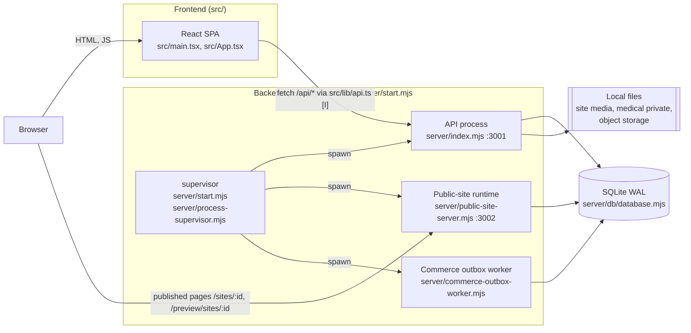
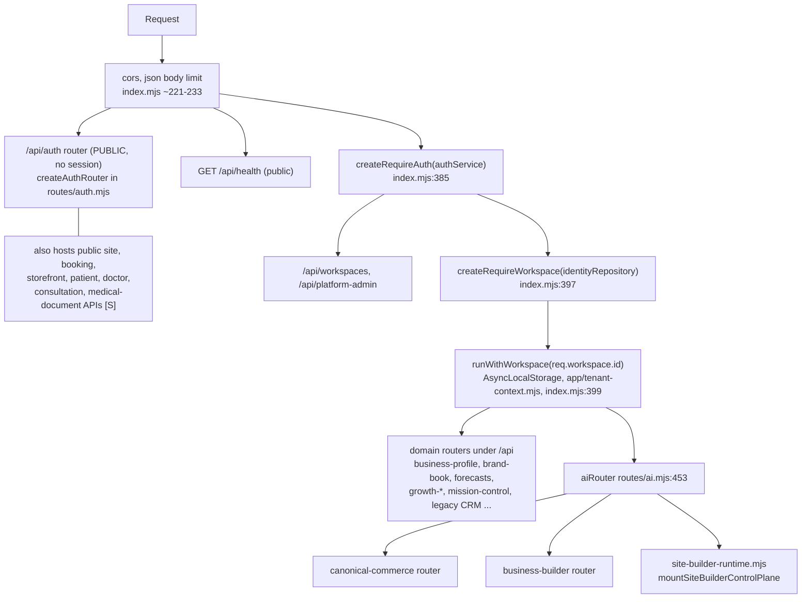
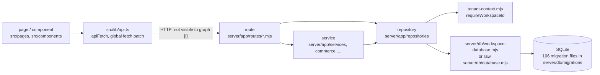
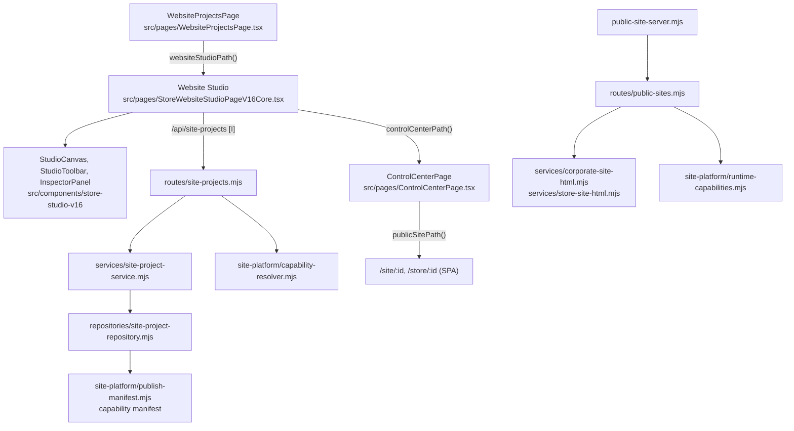
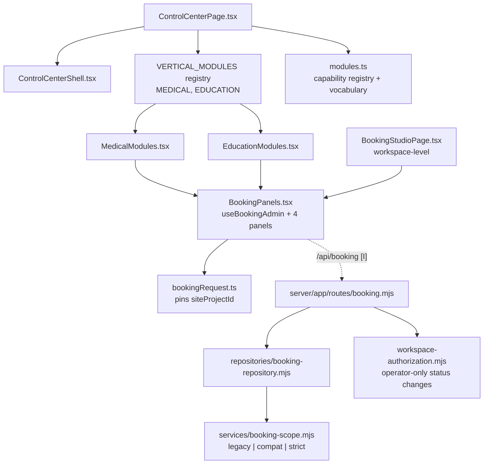
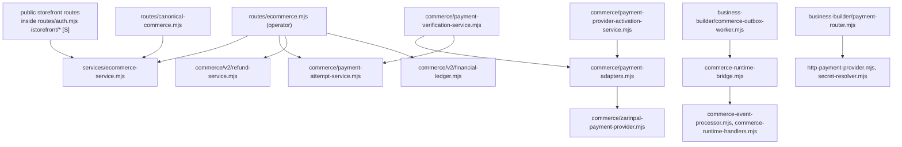
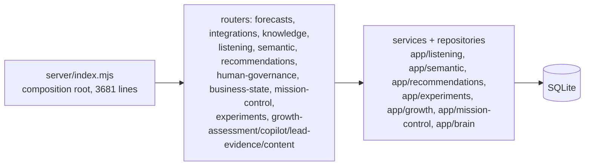
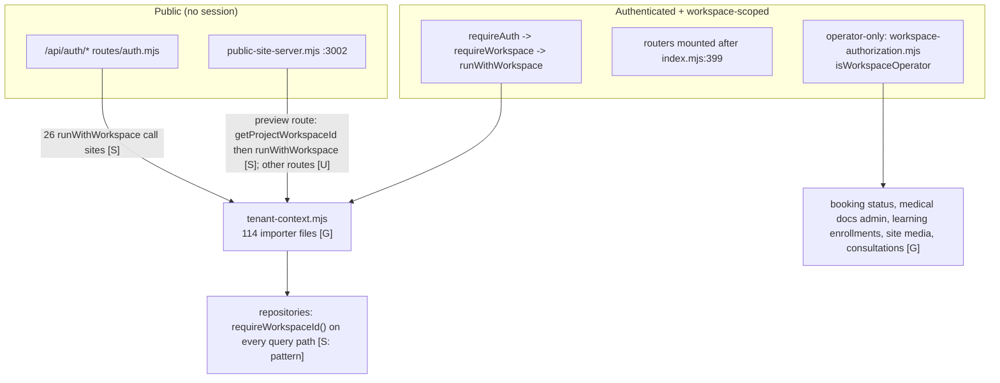
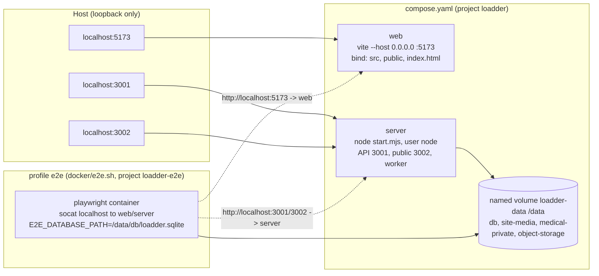

# Loadder runtime architecture map

Snapshot of the code at commit `5f62b94` (branch `automation/loadder-roadmap`). Companion documents:
[dependency audit](LOADDER_DEPENDENCY_AUDIT.md) · [Graphify workflow](LOADDER_GRAPHIFY_WORKFLOW.md) ·
[domain capability map](LOADDER_DOMAIN_CAPABILITY_MAP.md) · [Docker D1](../DOCKER_D1.md).

This map describes **implemented behaviour found in source**, not intended design. Where it could not be confirmed, the relationship is marked.

## Evidence legend

| Tag | Meaning |
|---|---|
| **[G]** | Static import/export edge, `EXTRACTED` in the Graphify graph (file and line anchored). Reproducible with `get_neighbors`. |
| **[S]** | Confirmed by reading the cited source lines. |
| **[I]** | Inferred, e.g. an HTTP path string matched between frontend and server, or a graph edge marked `INFERRED`. Plausible, not proven. |
| **[U]** | Unverified. Stated so a future reader does not mistake it for fact. |

**Blind spots (apply to every diagram):** Graphify sees imports, calls and containment only. It does **not** see HTTP calls between `src/` and `server/`, SQL tables/queries, Express route-to-handler wiring by path string, runtime configuration, or anything in `server/test/` and `e2e/` (excluded from the graph on purpose). Those links below are [S] or [I].

---

## 1. System / runtime topology

Two halves: the Vite/React frontend in `src/` and the Node/Express backend in `server/`. The backend is **three OS processes** started by one supervisor.

- Supervisor spawns the three children [S: `server/start.mjs:4-8`]. `npm run dev` (root `package.json`) instead runs Vite, `node --watch server/index.mjs` and `node --watch server/public-site-server.mjs` side by side [S]; the worker is **not** part of that dev command.
- All three processes open the same SQLite file through `server/db/database.mjs` (WAL, foreign keys on) [S]. Only `server/index.mjs` runs migrations (`runMigrations(db)`) [S].
- Published sites are reachable two ways: the SPA routes `/site/:id`, `/store/:id` rendered client-side [S: `src/App.tsx`], and the server-rendered runtime `/sites/:id`, `/preview/sites/:id`, plus Host-based custom domains [S: `server/app/routes/public-sites.mjs`].
- Health: `GET /api/health` only. The public-site runtime has no health route [S].

## 2. API request pipeline (tenant and auth order)

The order of `app.use(...)` in `server/index.mjs` *is* the security model. [S: `server/index.mjs` lines ~221-453, 3537]

- `routes/ai.mjs` imports `openai` and the Cloudflare agent executor **and** mounts `canonicalCommerceRouter`, `businessBuilderRouter` and `siteBuilderRouter` [S: `server/app/routes/ai.mjs:2-8,198-200`; G: `site-builder-runtime.mjs` ← `ai.mjs`]. Core builder, commerce and operator-booking APIs are therefore wired *through the AI router file*. See audit finding F1.
- `requireWorkspaceId()` throws when no workspace is in the async context [S: `server/app/tenant-context.mjs:9-15`], so repository code fails closed outside a tenant context.

## 3. Frontend → API → service → repository → database

Worked example, **site projects** (the most-called API family: ~114 string-literal call sites in `src/`, [I]):
`src/pages/StoreWebsiteStudioPageV16Core.tsx` → `src/lib/api.ts` → `/api/site-projects` [I] → `server/app/routes/site-projects.mjs` → `services/site-project-service.mjs` → `repositories/site-project-repository.mjs` → `site-platform/publish-manifest.mjs` [G for every server-side hop].

Layer facts: routes depend on services (75 file edges) more than on repositories directly (15) [G, aggregate]; `src/pages` depends on `src/lib` 95 times, and 86 files import `src/lib/api.ts` [G].

## 4. Website Studio and publishing

- Every server-side edge is [G] (e.g. `site-project-repository` → `publish-manifest`, `routes/public-sites` → the two HTML renderers).
- Studio ↔ Control Center ↔ public-site navigation is centralised in `src/components/control-center/modules.ts` (`controlCenterPath`, `websiteStudioPath`, `publicSitePath`, `bookingManagementPath`) and consumed by `StoreWebsiteStudioPageV16Core.tsx`, `WebsiteProjectsPage.tsx`, `DashboardPage.tsx` [G].
- Publishing content-to-snapshot semantics (versions, `getPublishedPublic`) live in repository SQL and were **not** traced here [U].
- Draft preview uses a hashed token against `repository.getPreviewByToken` [S: `routes/public-sites.mjs`].

## 5. Medical / Education shared Booking

One Control Center shell and one Booking engine; verticals only add modules and vocabulary.

- All frontend edges [G] (`src/components/control-center/*`, `src/pages/ControlCenterPage.tsx`, `src/pages/BookingStudioPage.tsx`).
- Server: `routes/booking.mjs` → `booking-repository.mjs` → `booking-scope.mjs` [G]; mounted by `site-builder-control-plane.mjs:85` [S]. Importers of the repository: `routes/booking.mjs`, `routes/auth.mjs`, `services/booking-identity.mjs`, `site-builder-control-plane.mjs`, `public-site-server.mjs` [G].
- Scope rules (Medical strict, others compat, no id = legacy) are documented in `docs/architecture/ADR-005-medical-vertical-phase0.md` and implemented in `booking-scope.mjs` [S].
- Medical and Education modules import only `BookingPanels`, `ui`, `modules` and `lib/api`; neither imports the other [G].

## 6. Commerce and payment lifecycle (structure only)

- All edges above are [G] file imports. The state machine (order, payment attempt, refund transitions), the callback and verification order, and idempotency behaviour were **not** traced [U].
- Two commerce code families exist: `server/app/commerce` (canonical store commerce) and `server/app/business-builder` (`payment-router`, `commerce-*` for generated business apps). Whether they share or duplicate behaviour is [U]; see audit finding F5.
- Payment callback URLs are derived from `req.protocol` and `Host` (`routes/auth.mjs:50-51`), which is why `TRUST_PROXY` matters behind TLS [S].

## 7. Intelligence and growth loop (structure only)

`server/index.mjs` instantiates and mounts about 30 intelligence/growth routers, each created from services and repositories built inline in the same file [S: `server/index.mjs` ~345-540].

- Directory sizes (files): `listening` 11, `experiments` 7, `growth` 6, `recommendations` 3, `semantic` 2, `mission-control` 1, `brain` 1, `orchestration` 2, `workers` 1 [S: filesystem].
- The data flow *between* these stages (events → features → forecasts → recommendations → experiments) was not traced end to end [U]. Use `docs/GROWTH_*` documents for intent; do not treat them as implemented behaviour.

## 8. Tenant and authorization boundaries

- 41 of 53 route files never import `tenant-context.mjs` or `workspace-authorization.mjs` [G]. They rely on being mounted after `index.mjs:397-399`. That ordering is the single guard for the whole authenticated surface [S].
- Public handlers enter a tenant explicitly. Whether **every** public route does so correctly is not provable from the graph [U]; the audit recommends a test that enumerates them.
- Only five files import the raw `db/database.mjs` handle: `workspace-database.mjs` (the wrapper), `commerce-outbox-worker.mjs`, `site-builder-runtime.mjs`, `scripts/assign-legacy-owner.mjs`, legacy `index.backup.mjs` [G].
- Booking adds a second boundary inside the tenant: site scope (`booking-scope.mjs`) [S].

## 9. Docker D1 runtime

Sources: `Dockerfile`, `compose.yaml`, `compose.e2e.yaml`, `docker/*.sh`, `.dockerignore` [S]. The tracked `server/db/loadder.sqlite` is never copied into an image or volume. This is a **development-only** stack (`NODE_ENV=development`, dev OTP exposed); production topology is a separate milestone (D2) and is not described here.

---

## Refreshing this map

1. `git rev-parse HEAD` vs the commit in the header; if they differ, run `graphify update .` (about 6 s, AST only).
2. Re-query only the affected nodes with `get_neighbors` (see the workflow doc).
3. Update the sections touched and the commit hash. Do not regenerate the whole file.
